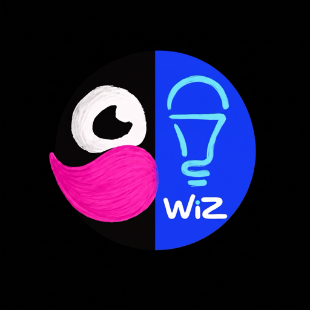

<p align="center"></p>

# gentle-wiz

Control WiZ smart lights from Gentle Shell / Pi with one slash command, over your LAN: JSON over UDP,
no cloud, no account, no credentials, no tokens. `/wiz` is parsed locally — the model never sees it.

## Install

```
pi install git:github.com/estebanhirzfeld/gentle-wiz
```

Restart Gentle Shell and `/wiz` is available.

## Configure

Write `~/.config/gentle-wiz/lights.json` by hand. `/wiz discover` prints a ready-to-paste file:

```json
{"lights":[{"name":"escritorio","ip":"192.0.2.26","mac":"aabbccddee01"}]}
```

## Commands

| Type | You get |
| --- | --- |
| `/wiz` | menu with every action (Enter picks, Esc cancels) |
| `/wiz on` `off` `toggle` `status` | power and state |
| `/wiz 40` | brightness 10–100 (`+10` / `-10`: relative to now) |
| `/wiz azul` · `/wiz #ffcc00` | a colour by name, or an exact one |
| `/wiz calido` · `/wiz 3200k` | a white by name, or exact kelvin 2200–6500 |
| `/wiz cozy` | a WiZ scene by name (1–32, named as the WiZ app does) |
| `/wiz pick` | live colour editor |
| `/wiz discover` · `/wiz help` | find lights · the command list |
| `/wiz escritorio azul` | target one light: `/wiz <light> <anything above>` |

Colours: `rojo` `naranja` `amarillo` `verde` `turquesa` `celeste` `azul` `violeta` `rosa` `magenta`.
Whites: `vela` `calido` `neutro` `frio` = 2200 / 2700 / 4000 / 6500 K.

Matching ignores case, accents and extra spaces, so the same text always does the same thing. Type
`/wiz ` and press Tab to see the options. A light named like a colour wins over the colour: `/wiz azul`
opens that light's menu, `/wiz azul azul` paints it blue. One light configured: its name is optional.
Several: `on`/`off`/`toggle` hit all of them, the rest ask you to name one. Every result reads the light
back, e.g. `▶ escritorio on, 40%`.

Colours and whites leave the scene (the command says so, `... (left scene 6)`); brightness keeps it.
Scene ids and names come from pywizlight; scenes above 32 are not offered yet.

## Live colour editor

`/wiz pick` (or `/wiz <light> pick`) opens three bars — **Tono**, **Brillo**, **Saturación** — starting
from the light's current colour and brightness.

- ↑↓ pick a bar, ←→ change it. Every change goes to the light in real time: at most 8 sends per second,
  only the last value, never two at once.
- **Enter** confirms: `Color #rrggbb, dimming N% on <light>`.
- **Esc** cancels and restores the light exactly as it was; if you never moved a bar, nothing is sent.
- Known limit: a light that was off can come back in the previewed colour instead of the old one (not
  verified on real hardware).
- With several lights, name one — a live editor must not move them all.

## Protocol

Port 38899 UDP per light: `getPilot` reads, `setPilot` writes and answers `{"success": true}`. Discovery
broadcasts to every interface's /24 plus `255.255.255.255`. UDP drops datagrams, so every call retries
(3 tries, 1 s each) and reports `no answer from <name> (<ip>)` instead of pretending it worked.

## Verified hardware

One device: WiZ **ESP25_SHRGB_01** (RGB + tunable white), firmware **1.38.0**. Writes `state`, `dimming`,
`temp`, `r`/`g`/`b`, `sceneId`; dimming keeps `sceneId`; `temp` and `color` leave the scene. Other models
or firmware may behave differently.

## Development

```
npm test    # node --test test/*.test.ts — fakes only, no network, no real light
```

Every external effect is injected (`src/wiz.ts` is the testable engine, `src/extension.ts` the thin
command), so the suite never sends a datagram. No timers, no polling, no sidebar row.
